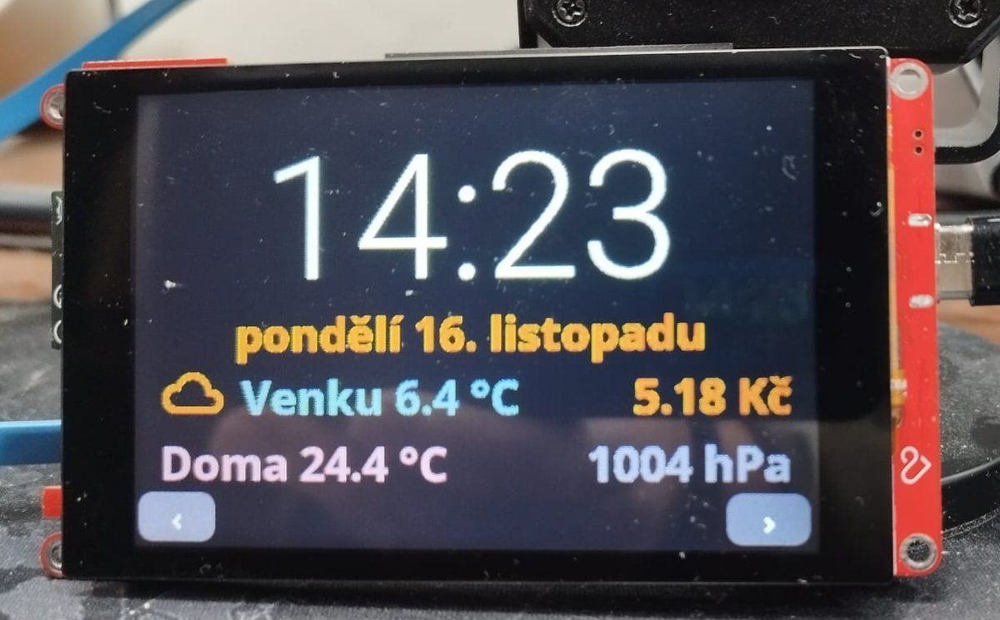
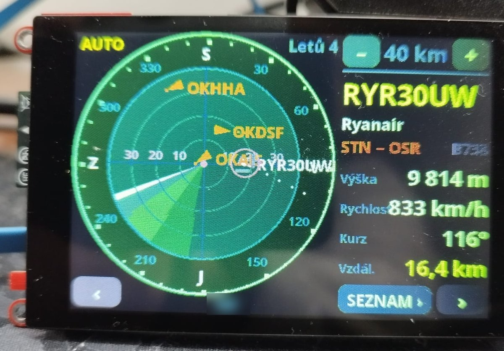

# MeteoPlaneRadar pro LaskaKit ESPD-3.5 (ESPHome + LVGL)

Dotykový displej s hodinami, počasím, meteostanicí z Home Assistantu, radarem letadel v okolí a spotovou cenou elektřiny. Vše běží v ESPHome, data se stahují přímo z internetu zdarma a bez API klíčů.

🇬🇧 [English version](README.md)

| Hodiny | Letadla | Meteostanice |
|---|---|---|
|  |  |  |

## Obrazovky

1. **Hodiny**: čas, datum, ikona počasí, teplota venku a doma, tlak, aktuální spotová cena. Klepnutím na údaj změníš jeho barvu.
2. **Počasí + ovzduší**: aktuální stav a předpověď na 3 dny, index kvality ovzduší (EAQI).
3. **Meteostanice**: 4 dlaždice s teplotou a vlhkostí z čidel v Home Assistantu.
4. **Letadla**: radar (zoom 10 až 150 km, kruhy v km), údaje o letu (volací znak, aerolinka, trasa, typ, výška v m, rychlost v km/h, kurz, vzdálenost), režim AUTO / PAUZA, seznam 4 nejbližších letadel.
5. **Elektřina**: graf spotové ceny (CZ) na dnešek.
6. **Energetický mix**: složení výroby elektřiny v ČR, podíl OZE.
7. **Systém / nastavení**.

## Hardware

- **LaskaKit ESPD-3.5** (ESP32-S3, 16 MB flash, 8 MB PSRAM, verze desky Rev 3.2), 3,5" displej ILI9488 480×320 s kapacitním dotykem FT5x06. Nic dalšího není potřeba.
- Volitelně Li-Pol baterie (měří se napětí a procenta).

| Funkce | GPIO |
|---|---|
| Displej SPI CS / DC | 48 / 47 |
| Displej RST | na EN (nepoužívá se) |
| Podsvícení (PWM) | 45 |
| Dotyk FT5x06 (I²C 0x38), INT | 10 |
| I²C SDA / SCL | 42 / 2 |
| Čidlo SHT40 na desce (0x44) | I²C |
| Měření baterie (ADC, dělič ×1,769) | 9 |
| GPIO16 | vypnutí desky, **nepoužívat** |

Pozor: popisky CS/DC/INT na plošném spoji některých kusů neodpovídají, platí tabulka výše (podle LaskaKit Setup303 pro TFT_eSPI).

## Instalace

1. V ESPHome Builderu (doplněk Home Assistantu) vytvoř nové zařízení a vlož obsah `espd35-meteoplaneradar.yaml`.
2. Do Secrets (`secrets.yaml`) doplň údaje podle `secrets.example.yaml`. Šifrovací klíč API si vygeneruj vlastní.
3. V bloku `substitutions` na začátku YAML nastav:
   - `home_lat`, `home_lon`: výchozí poloha (radar, počasí),
   - `phone_tracker`: volitelně `device_tracker` mobilu, aby se radar a počasí přesouvaly s tebou,
   - entity čidel z tvého Home Assistantu (venku, doma, tlak, dlaždice 2 a 4) a názvy dlaždic,
   - `use_ha_remote: "true"`, pokud chceš číst čidla i mimo domov přes Nabu Casa (jinak nech `"false"`).
4. Poprvé nahraj přes USB, další aktualizace jdou bezdrátově (OTA).
5. V Home Assistantu přidej zařízení (ESPHome integrace se ho obvykle sama zeptá) a zadej šifrovací klíč API ze `secrets.yaml`.

Za běhu se dá nastavit přes web `http://<IP desky>` nebo v HA: poloha, poloměr radaru, upozornění na blízká letadla, kurz EUR/CZK, barvy údajů na hodinách, jas podsvícení.

Entity, které nemáš, můžeš nechat jak jsou, údaj pak ukazuje „--“.

## Zdroje dat (zdarma, bez registrace)

| Data | Zdroj |
|---|---|
| Počasí a předpověď | [Open-Meteo](https://open-meteo.com) |
| Kvalita ovzduší | [Open-Meteo Air Quality](https://open-meteo.com/en/docs/air-quality-api) |
| Letadla (ADS-B) | [adsb.fi Open Data](https://github.com/adsbfi/opendata) |
| Aerolinka a trasa letu | [adsbdb.com](https://www.adsbdb.com) |
| Název místa pod radarem | [BigDataCloud reverse geocoding](https://www.bigdatacloud.com) |
| Spotová cena, mix výroby | [Energy-Charts (Fraunhofer ISE)](https://energy-charts.info) |

Ceny a mix jsou nastavené pro Českou republiku (`bzn=CZ`, `country=cz`), časové pásmo `Europe/Prague`. Pro jinou zemi stačí v YAML upravit tyto řetězce.

## Poznámky

- Stahování běží postupně v jednom cyklu (nikdy dvě HTTPS spojení naráz), aby ESP32 nedošla paměť.
- Čidlo SHT40 na desce měří kvůli ohřevu od elektroniky víc než okolí, proto se pro „Doma“ používá čidlo z HA.
- Při nabíjení malé baterie hlídej teplotu, nabíjecí proud desky je 0,5 A.
- Inspirováno projekty MeteoPlaneRadar (petus, MIT) a Flight Tracker 360.
