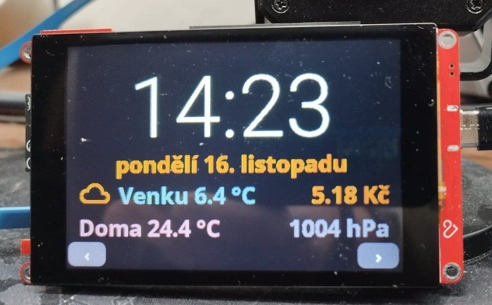
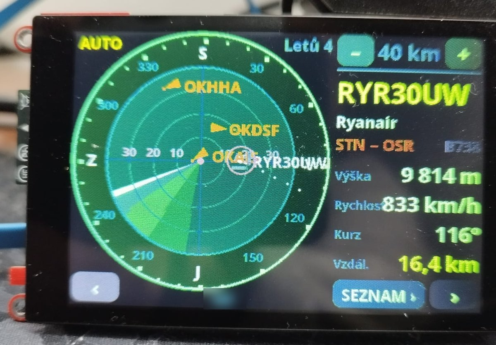

# MeteoPlaneRadar for LaskaKit ESPD-3.5 (ESPHome + LVGL)

Touchscreen dashboard with a clock, weather, Home Assistant sensor tiles, a live radar of aircraft around you and the spot electricity price. Everything runs in ESPHome; all data comes straight from free public APIs, no API keys needed.

🇨🇿 [Česká verze](README.cs.md)

| Clock | Aircraft radar | Weather station |
|---|---|---|
|  |  |  |

## Screens

1. **Clock**: time, date, weather icon, outdoor and indoor temperature, pressure, current spot price. Tap any value to change its colour.
2. **Weather + air quality**: current conditions, 3-day forecast, European Air Quality Index (EAQI).
3. **Weather station**: 4 tiles with temperature and humidity from your Home Assistant sensors.
4. **Aircraft**: radar (zoom 10–150 km, range rings in km), flight details (callsign, airline, route, aircraft type, altitude in m, speed in km/h, heading, distance), AUTO / PAUSE mode, list of the 4 nearest aircraft.
5. **Electricity**: today's spot price chart (Czech market).
6. **Energy mix**: Czech electricity generation mix, renewables share.
7. **System / settings**.

The on-screen texts are in Czech; they are plain strings in the YAML and easy to translate.

## Hardware

- **LaskaKit ESPD-3.5** (ESP32-S3, 16 MB flash, 8 MB PSRAM, board Rev 3.2), 3.5" ILI9488 480×320 display with FT5x06 capacitive touch. Nothing else is required.
- Optional Li-Po battery (voltage and percentage are measured).

| Function | GPIO |
|---|---|
| Display SPI CS / DC | 48 / 47 |
| Display RST | tied to EN (not used) |
| Backlight (PWM) | 45 |
| Touch FT5x06 (I²C 0x38), INT | 10 |
| I²C SDA / SCL | 42 / 2 |
| On-board SHT40 sensor (0x44) | I²C |
| Battery voltage (ADC, divider ×1.769) | 9 |
| GPIO16 | board power-off, **do not use** |

Note: the CS/DC/INT silkscreen labels on some boards are wrong; the table above is correct (matches LaskaKit's Setup303 for TFT_eSPI).

## Installation

1. In ESPHome Builder (Home Assistant add-on) create a new device and paste the contents of `espd35-meteoplaneradar.yaml`.
2. Fill in your Secrets (`secrets.yaml`) using `secrets.example.yaml`. Generate your own API encryption key.
3. Edit the `substitutions` block at the top of the YAML:
   - `home_lat`, `home_lon`: default location (radar, weather),
   - `phone_tracker`: optional phone `device_tracker`, so radar and weather follow you,
   - entity IDs of your Home Assistant sensors (outdoor, indoor, pressure, tiles 2 and 4) and tile names,
   - `use_ha_remote: "true"` if you want to read the sensors when away from home via Nabu Casa (otherwise keep `"false"`).
4. Flash over USB the first time; later updates go over the air (OTA).
5. Add the device in Home Assistant (the ESPHome integration usually discovers it) and enter the API encryption key from `secrets.yaml`.

At runtime you can change location, radar radius, nearby-aircraft alert, EUR/CZK rate, clock colours and backlight brightness via the web UI `http://<board IP>` or in Home Assistant.

Entities you don't have can stay as they are; the value just shows "--".

## Data sources (free, no registration)

| Data | Source |
|---|---|
| Weather and forecast | [Open-Meteo](https://open-meteo.com) |
| Air quality | [Open-Meteo Air Quality](https://open-meteo.com/en/docs/air-quality-api) |
| Aircraft (ADS-B) | [adsb.fi Open Data](https://github.com/adsbfi/opendata) |
| Airline and route | [adsbdb.com](https://www.adsbdb.com) |
| Place name under the radar | [BigDataCloud reverse geocoding](https://www.bigdatacloud.com) |
| Spot price, generation mix | [Energy-Charts (Fraunhofer ISE)](https://energy-charts.info) |

Price and mix are set for the Czech Republic (`bzn=CZ`, `country=cz`) and the time zone is `Europe/Prague`. For another country just change these strings in the YAML.

## Notes

- Downloads run one after another in a single loop (never two HTTPS connections at once) so the ESP32 doesn't run out of memory.
- The on-board SHT40 reads higher than the room because of heat from the electronics, so "indoor" uses a sensor from HA.
- Watch the temperature when charging a small battery; the board's charge current is 0.5 A.
- Inspired by MeteoPlaneRadar (petus, MIT) and Flight Tracker 360.
